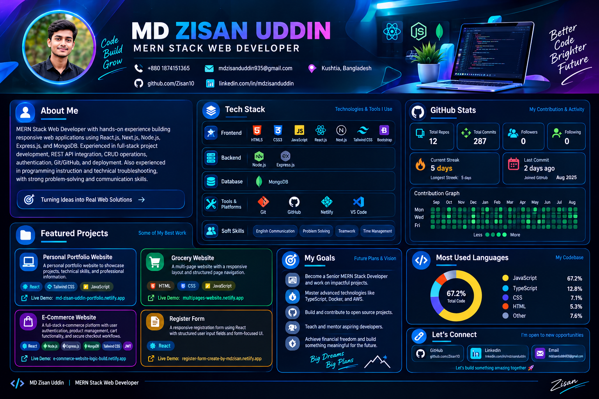

<!-- GitHub Profile README for MD Zisan Uddin. Repository name must match username: Zisan10. -->

  
  <h1>Hi, I'm MD Zisan Uddin 👋</h1>
  <h3>💻 MERN Stack Web Developer | Building Responsive Web Experiences</h3>
  

    
    
    
  

  

---

## 👨‍💻 About Me

I'm a **MERN Stack Web Developer** based in **Kushtia, Bangladesh**, with hands-on experience building responsive websites and full-stack web applications. I work with React.js, Next.js, Node.js, Express.js, and MongoDB, and have experience with REST API integration, CRUD operations, authentication, Git/GitHub, and deployment.

- 💻 Building responsive interfaces and practical web applications.
- 🌱 Continuously improving my full-stack development skills.
- 🔌 Turning UI/UX designs into working interfaces and integrating REST APIs.
- 🧑‍🏫 Experienced in teaching programming fundamentals.
- 📍 Kushtia, Bangladesh

---

## 🧰 Tech Stack

**Frontend**

  

**Backend & Database**

  

**Tools & Platforms**

  

**Core Skills**

  
  
  
  

---

## 🚀 Featured Projects

<table>
  <tr>
    <td width="50%" valign="top">
      <h3>🌐 Personal Portfolio Website</h3>
      
A portfolio presenting my projects, technical skills, and professional information.

      
<strong>Built with:</strong> React.js, Tailwind CSS, JavaScript

      <a href="https://md-zisan-uddin-portfolio.netlify.app/">🔗 Live Demo</a>
    </td>
    <td width="50%" valign="top">
      <h3>🛍️ E-Commerce Website</h3>
      
A full-stack store with authentication, product management, cart functionality, and checkout workflows.

      
<strong>Built with:</strong> React, Node.js, Express.js, MongoDB, Tailwind CSS, JWT

      <a href="https://e-commerce-website-logic-build.netlify.app/">🔗 Live Demo</a>
    </td>
  </tr>
  <tr>
    <td width="50%" valign="top">
      <h3>🧺 Grocery Website</h3>
      
A multi-page website with a responsive layout and structured page navigation.

      
<strong>Built with:</strong> HTML, CSS, JavaScript

      <a href="https://multipages-website.netlify.app/">🔗 Live Demo</a>
    </td>
    <td width="50%" valign="top">
      <h3>📝 Register Form</h3>
      
A responsive registration form built with React and structured input fields.

      
<strong>Built with:</strong> React.js

      <a href="https://register-form-create-by-mdzisan.netlify.app/">🔗 Live Demo</a>
    </td>
  </tr>
</table>

---

## 📈 GitHub Statistics

  
  

### 💻 Most Used Languages

  

Stats are generated by external services. Language percentages reflect repository code those services can access, not overall skill level. Cards may occasionally be unavailable.

---

## 🎯 My Goals
- 📚 Deepen my knowledge of React.js, Next.js, and full-stack architecture.
- 🏗️ Build useful projects with clean, maintainable code.
- 🔐 Improve my understanding of authentication, API design, and secure workflows.
- 🤝 Collaborate with developers and contribute to meaningful projects.
- 🧑‍🏫 Share what I learn and help others understand programming.

---

## 💼 Experience & Education

**Freelance Web Developer** · *2024–Present*
- Develop responsive websites and web applications using modern JavaScript technologies.
- Convert UI/UX designs into functional interfaces, integrate REST APIs, and deploy projects.

**Programming Trainer** · *Polytechnic Care*
- Teach programming fundamentals, coding logic, and practical problem-solving.

**Education**
- Diploma in Computer Science & Technology — **Kushtia Govt. Polytechnic Institute**
- Expected completion: **2027**

---

## 🌍 Languages
- Bengali — Native
- English — Intermediate

---

## 🤝 Let's Connect
I'm happy to connect with developers, discuss web development, and explore opportunities to build useful digital products.

  
  
  
  <h3>✨ Keep learning. Keep building. Keep improving. ✨</h3>

